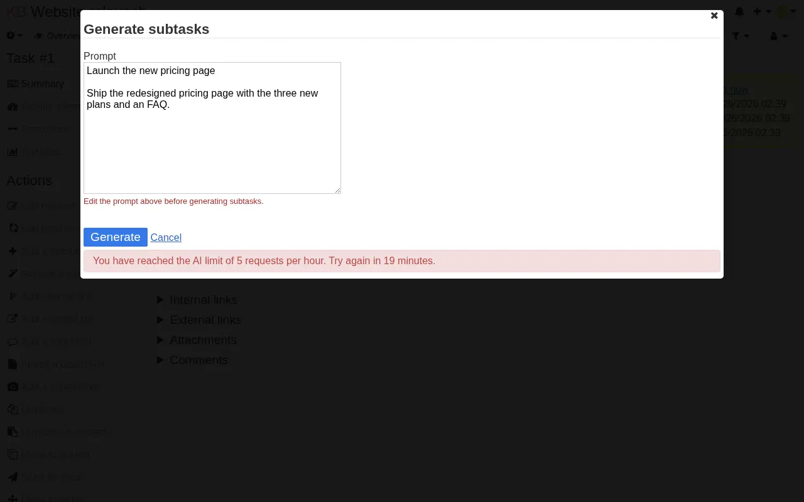

# SubtaskGenerator — Kanboard Plugin

Generate candidate subtasks from a task description using AI. SubtaskGenerator
no longer talks to a provider directly — it consumes the **[AiConnector](../AiConnector/README.md)**
plugin, which is **required** and supplies the provider backend (Anthropic,
OpenAI, OpenAI Responses, Grok, Gemini, Mistral, or Ollama).

## Requirements

- Kanboard >= 1.2.47
- PHP >= 8.4
- **[AiConnector](../AiConnector/README.md) >= 1.4.0**, installed and active,
  with at least one provider profile configured and ready. This is declared as a
  hard `requires` in `plugin.json`. Kanboard core does not itself parse
  `requires`, so it will not block activation; the dependency is *enforced* by the
  [ModMenu](../ModMenu/README.md) plugin manager (install/enable/disable gates).
  Without ModMenu, SubtaskGenerator still degrades gracefully at runtime: if
  AiConnector is absent or has no ready profile, the AI features stay hidden and
  the routes return 403 (no fatal).

## Installation

1. Install and configure **AiConnector** first (see its README) — add at
   least one provider profile and mark one as the default.
2. Copy or clone this directory to `<kanboard-root>/plugins/SubtaskGenerator/`.
3. Set file permissions so the web server can read the plugin:
   ```
   chmod -R o+rX SubtaskGenerator/
   ```
4. Go to **Settings → Plugins** in Kanboard to confirm both plugins are
   active.

SubtaskGenerator ships no vendored dependencies of its own — there is no
`composer install` step for this plugin.

## Provider Configuration

Provider/model/API-key configuration lives entirely in **Settings → AI
Connector** (the AiConnector plugin), not in SubtaskGenerator. See
AiConnector's README for provider types, key storage, and env-var fallbacks.

### Point-of-use model picker

The Generate-subtasks modal uses AiConnector's shared **AI model** picker. Which
model runs, and whether you may switch it, is decided by AiConnector's model
routing for the feature `subtaskgenerator.generate` (listed as **Generate
subtasks**):

- An admin chooses which profiles are **Available to users** in AiConnector's
  settings, and can assign (and **Lock**) a model for this feature under
  **Model routing**. A locked feature always uses the admin's model and shows no
  picker.
- A project manager can set an **AI profile for this project** and turn on
  **Let members switch the AI model**; only then do members see the picker in
  that project.
- When the picker is hidden, or the posted choice is not one of the offered
  profiles, the model is chosen by routing (project, feature, plugin, then the
  global default) and the choice is ignored.

## API Key Security

API keys are stored and secured entirely by AiConnector — see its README for
details (separate storage key, masked UI, never logged, env-var fallback).
SubtaskGenerator itself never reads or stores a key.

## Usage Walkthrough

1. Open any task in Kanboard.
2. In the task sidebar, click **Generate subtasks** (appears only when
   AiConnector reports at least one ready provider profile).
3. If the **AI model** picker is shown, optionally pick a model from it.
4. Review and optionally edit the pre-filled prompt (the task title and
   description are used as the default prompt).
5. Click **Generate**. The plugin calls the model chosen by routing
   via AiConnector and displays a candidate checklist.
6. Uncheck any subtasks you do not want, and edit titles inline if needed.
7. Click **Create** to persist the selected subtasks on the task.
8. You are redirected back to the task view with a flash notice showing how
   many subtasks were created.

If the provider is unreachable, times out, or returns malformed output, a friendly error message is shown in the modal — nothing is created, and the page does not 500.

Each **Generate** counts against AI Connector's AI limits (a per-person hourly
quota and a longest-request cap, set by an admin). Past either one, the modal
says why and nothing is sent to the provider:



## Graceful Degradation

- **PHP < 8.4:** the plugin loads cleanly, AI features are disabled, the sidebar link is hidden.
- **No ready AiConnector profile, or AiConnector older than 1.4.0:** same — AI features are disabled, the sidebar link is hidden.
- **Provider error (network, timeout, malformed output, empty result):** the modal shows a friendly error message; no subtasks are created; no page crash.
- **Partial create failure:** if one subtask cannot be saved to the database, the remaining subtasks are still created. The flash notice reports both the created and failed counts.

## License

MIT — see [LICENSE](LICENSE).
